  

## About Me

- Final-year B.Tech Computer Science and Engineering student at Lovely Professional University.
- CGPA: 8.86
- Interested in Data Science, Machine Learning, AI, and Data Analytics.
- Experienced in building predictive models, interactive dashboards, and data-driven applications.
- Currently strengthening my problem-solving, SQL, and machine learning skills.
- Exploring scalable data processing and intelligent application development.

I enjoy transforming complex data into meaningful insights and building practical solutions to real-world problems.

## Technical Skills

**Programming:** Python, C++, SQL

**Data Science & Analytics:** Pandas, NumPy, Scikit-learn, Matplotlib, Seaborn, Excel, Power BI

**Machine Learning:** Regression, Classification, Feature Engineering, Model Evaluation

**Big Data:** PySpark, Apache Spark, Hadoop, HDFS, Hive, HBase, Cassandra

**Databases:** MySQL, MongoDB

**Development & Tools:** Git, GitHub, VS Code, Jupyter Notebook, Streamlit, React, Node.js

## Featured Projects

A selection of projects across Data Science, Machine Learning, Big Data, Business Intelligence, and AI-powered applications.

### 1. LYRA - AI-Powered Voice Assistant
A Python-based desktop voice assistant that enables voice-controlled interactions, web automation, information retrieval, and productivity tasks.

**Technologies:** Python, Groq, Cohere, Hugging Face, Selenium, PyQt5, Edge TTS

### 2. EchoChamber - AI-Moderated Real-Time Debate Platform
A real-time debate platform featuring AI-powered moderation, live communication, and interactive debate experiences.

**Technologies:** React, Node.js, Express.js, MongoDB, Socket.io, Gemini API, Redis

### 3. Public Transport Ridership Prediction
A large-scale predictive analytics project using NYC public transport data, weather information, and calendar features to forecast hourly bus ridership.

**Technologies:** Python, PySpark, Spark MLlib, Pandas, Power BI

### 4. India Socio-Demographic Insights
An interactive business intelligence project exploring Census 2011 data to identify demographic patterns and socio-economic insights across India.

**Technologies:** Power BI, Data Analytics, Data Visualization, Excel

### 5. Smart Course Recommendation System
A personalized course recommendation and learning analytics application that uses student skills, interests, and course ratings to generate recommendations.

**Technologies:** Python, MongoDB, PyMongo, Streamlit, Pandas, Plotly

### 6. Heart Disease Prediction
A machine learning classification project that predicts the likelihood of heart disease using patient health attributes and Logistic Regression.

**Technologies:** Python, Pandas, NumPy, Scikit-learn, Matplotlib

### 7. Shark Tank Analysis
An exploratory data analysis project examining Shark Tank investment data to uncover patterns in startup funding, investor participation, and deal-making.

**Technologies:** Python, Pandas, NumPy, Matplotlib, Seaborn

---

## Achievements & Certifications

- Dean's Top 10% Students at University - November 2025
- Smart India Hackathon 2025 - University Level Selection
- HackerRank Python - 5 Star Certification
- AlgoUniversity Graphs Camp - Selected among 4,000 shortlisted candidates from 40,000 applicants
- GirlScript Summer of Code 2026 - Open Source Contributor
- Republic of Cyber Sentinels - 24-Hour CTF Participant

## GitHub Analytics

  

  

  

  

## Let's Connect

  
  
  

  Open to learning, collaboration, and opportunities in Data Science, Machine Learning, and AI.

---

  <i>Building, learning, and turning ideas into impact.</i>

