

  

  

  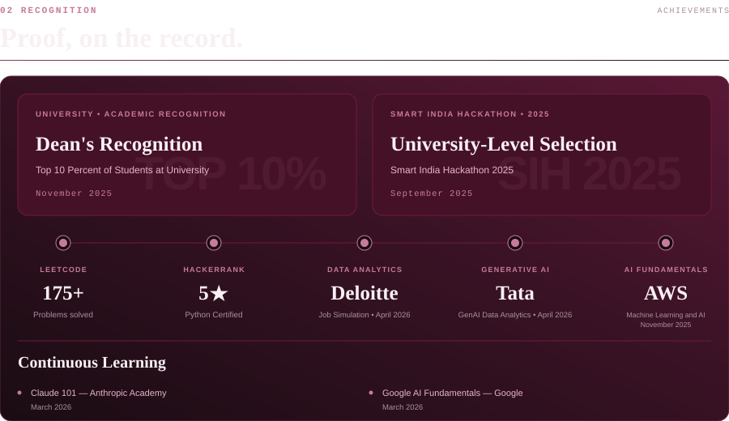

  

<a href="https://github.com/Gaurikabhatt27/Lyra-PC-Assistant-">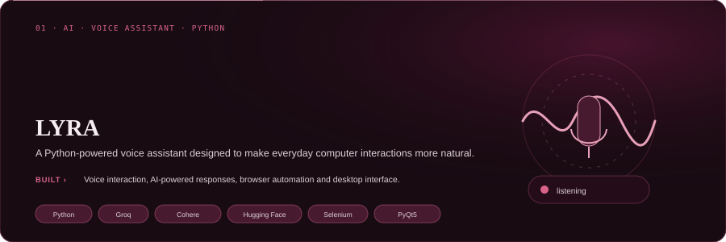</a>

<a href="https://github.com/Gaurikabhatt27/EchoChamber-backend"></a>

<a href="https://github.com/Gaurikabhatt27/predicting_public_transport_ridership"></a>

<a href="https://github.com/Gaurikabhatt27/india-socio-demographic-insights"></a>

<a href="https://github.com/Gaurikabhatt27/Smart_Course_Recommendation_System"></a>

<a href="https://github.com/Gaurikabhatt27/Heart_Disease_Prediction">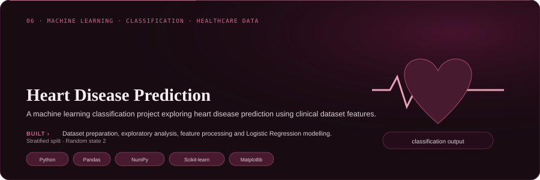</a>

<a href="https://github.com/Gaurikabhatt27/Shark-Attack-Data-Analysis-Python-EDA-Project">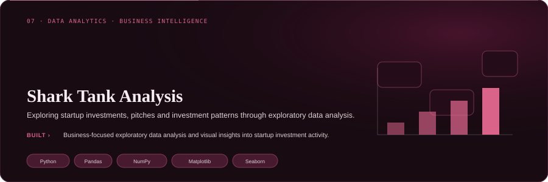</a>

  

  

  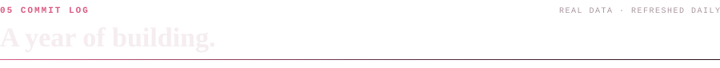

  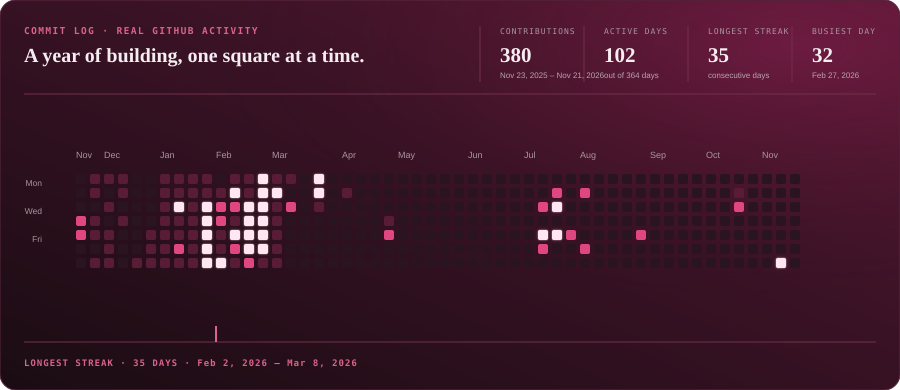

  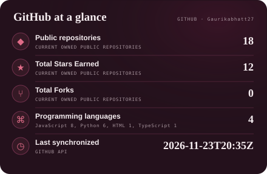

  

  

  

  
  

  
  

  

